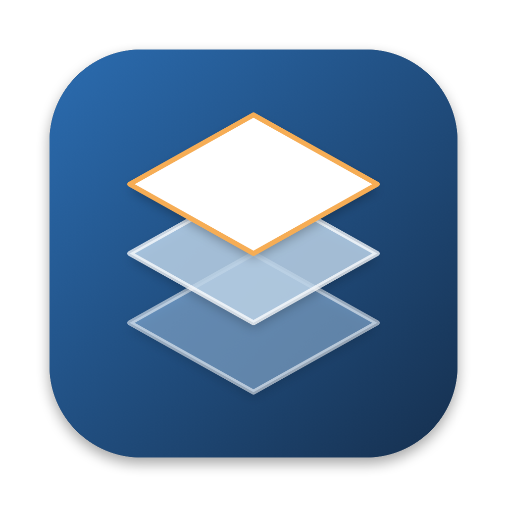

<div align="center">
  
  <h1>Orca Profile Studio</h1>
  <p><em>看清、检查、安全地修改 OrcaSlicer 系统预设的桌面工具</em></p>
  <p><a href="README.md">English</a> · 中文</p>
  <p>
    <a href="docs/user-guide_CN.md">使用手册</a> ·
    <a href="docs/reference/profile_format_spec.md">配置格式说明</a> ·
    <a href="docs/roadmap.md">路线图</a>
  </p>
  <a href="https://github.com/shixiaozhong/orca-profile-studio/actions/workflows/ci.yml"></a>
  
  
  <a href="LICENSE"></a>
</div>

<!-- 截图：放到 docs/images/ 后在这里引用，例如主界面 + Values 页 -->

> 个人维护的非官方工具，与 OrcaSlicer 项目、SoftFever 和 Snapmaker 均无隶属关系，也未获得它们的认可。仓库里没有从 OrcaSlicer 导出或复制的文件，工具只读取你指定目录里的预设文件。

## 为什么

OrcaSlicer 的系统预设（`resources/profiles`）是一大批相互继承的 JSON 文件：57 个厂商、约 7,100 个预设，最深 6 层继承，再加上 14,000 多条兼容记录和条件表达式。想知道一个预设的实际值，要沿着 `inherits` 一层层翻文件；清单顺序写错、父项找不到时，OrcaSlicer 只写一条日志就跳过，甚至整个厂商都不加载；改一个名字，要同步清单、继承和各处兼容列表。

Orca Profile Studio 按 OrcaSlicer 自己的加载规则解析这些文件，把最终值、问题和兼容性都摆在眼前，修改时只动真正变化的那几行，所有写盘操作都先预览、可撤销。

## 快速开始

需要 [Rust](https://rustup.rs) 1.95+，以及一份 OrcaSlicer 预设：源码检出、已安装的 OrcaSlicer，或单独的 `resources/profiles` 目录都可以。

```bash
git clone https://github.com/shixiaozhong/orca-profile-studio.git
cd orca-profile-studio
cargo run --release -p profile-studio                    # 启动后点「打开目录…」（⌘O）
cargo run --release -p profile-studio -- ../OrcaSlicer   # 或者直接指定目录
```

<details>
<summary>打包成 macOS 应用</summary>

```bash
scripts/bundle-macos.sh             # 生成 target/release/bundle/Orca Profile Studio.app
scripts/bundle-macos.sh --install   # 同时复制到 ~/Applications/
```

本地使用的 ad-hoc 签名，不做公证。只有从 `.app` 启动时 macOS 的系统通知才可用。

</details>

<details>
<summary>打包成 Windows 免安装 zip</summary>

在 Windows 上用 MSVC 工具链（不支持从 Mac 交叉编译）：

```powershell
powershell -ExecutionPolicy Bypass -File scripts\package-windows.ps1
```

生成 `target\release\package\orca-profile-studio-<版本>-windows-<x64|arm64>.zip`，解压后双击 `Orca Profile Studio.exe` 即可。exe 没有签名，SmartScreen 拦截时点「更多信息」→「仍要运行」。

</details>

<details>
<summary>命令行工具</summary>

```bash
cargo run --release -p profile-tool -- --profiles ../OrcaSlicer check
```

`--profiles` 也可以用环境变量 `ORCA_PROFILES_DIR` 代替。

</details>

## 功能

- **最终值和来源**：每个键的最终值来自继承链的哪一层，每一层写了什么，被覆盖的值一目了然
- **结构检查**：清单、继承、重名、机型与喷嘴规格、兼容性条件、文件编码等 20 多类问题，级别按 OrcaSlicer 的实际加载行为划分，加载从不中断
- **兼容性**：按 OrcaSlicer 的规则算出每个耗材、工艺能在哪些打印机上选到，以及原因；与 OrcaSlicer 自己的判定对照约 400 万个组合，0 处差异
- **全局搜索**：⌘K 同时搜预设名、配置键和文件里写的值，例如 `nozzle_temperature 270`
- **预设对比**：两个同类型预设并排对比最终值和来源，可以跨厂商，包含未保存的修改
- **保留格式的编辑**：保存时只替换变化的值，缩进、数组写法、BOM 和换行都不动；撤销、重做，保存前先预览
- **批量编辑**：给一组预设设置或删除键、追加或移除数组元素，逐个预览，整组撤销；把兄弟预设的相同值一步提到父项
- **预设和机型管理**：新建、复制（含整组复制）、重命名、删除，自动同步清单、继承和各处引用；事务式写入，失败回滚
- **任意版本**：打开任意目录，识别 OrcaSlicer 检出、安装目录和 `.app`；多窗口并排看不同版本
- **命令行**：`check`、`resolve`、`search`、`compat` 等子命令，`check` 可以直接放进 CI
- **中英文界面**：跟随系统或手动切换；亮色、暗色和跟随系统的主题

## 平台

| 平台 | 桌面应用 | 命令行 | 打包 |
|---|---|---|---|
| macOS | ✅ | ✅ | `.app`（`scripts/bundle-macos.sh`） |
| Windows | ✅ | ✅ | 免安装 zip（`scripts/package-windows.ps1`） |
| Linux | — | ✅ | — |

三个平台都在 CI 上跑测试和真实数据回归；桌面应用的界面测试在 macOS 和 Windows 上跑。

## 使用

| 操作 | macOS | Windows |
|---|---|---|
| 打开目录 | `⌘O` | `Ctrl+O` |
| 搜索与命令面板 | `⌘K` | `Ctrl+K` |
| 保存（先预览） | `⌘S` | `Ctrl+S` |
| 撤销 / 重做 | `⌘Z` / `⇧⌘Z` | `Ctrl+Z` / `Ctrl+Shift+Z` |
| 新窗口 | `⌘N` | `Ctrl+N` |
| 关闭窗口 / 退出 | `⌘W` / `⌘Q` | `Ctrl+W` / `Ctrl+Q` |

| 子命令 | 作用 |
|---|---|
| `stats` | 厂商、机型、预设数量，继承深度，问题汇总 |
| `check` | 列出问题，可按厂商和级别筛选；有 error 时退出码为 1 |
| `resolve <预设>` | 继承链和每个键的最终值 |
| `search <查询>` | 搜索预设、配置键和文件里写的值 |
| `compat <预设>` | 兼容的打印机及原因，或一台打印机能用的工艺和耗材 |
| `compat-check <表>` | 和 OrcaSlicer 导出的兼容性表逐项对照 |

每个界面功能和子命令的详细说明见[使用手册](docs/user-guide_CN.md)。

## 设计原则

- **复刻 OrcaSlicer 的加载语义**：厂商、分类和清单顺序，整键覆盖，跨厂商继承的唯一来源，BOM 的处理，都与 OrcaSlicer 一致，规则和源码出处写在[配置格式说明](docs/reference/profile_format_spec.md)里
- **只分析预设文件本身**：不内嵌 OrcaSlicer 的配置项定义（类型、默认值、取值范围），不和某个 OrcaSlicer 版本绑定
- **写盘前一定先预览**：所有修改先进入可撤销的会话，确认后才事务式写入
- **只报告，不替你修数据**：检查出的问题只列出来，不自动修改任何配置

## 常见问题

- **会改动我的 OrcaSlicer 检出吗？** 只在你确认保存或确认文件操作时写入，而且只写你打开的那个目录。建议在 Git 检出里使用，随时可以用 `git diff` 查看、用 Git 还原。
- **为什么有些键没有值？** 整条继承链都没写的键，默认值在 OrcaSlicer 的 C++ 源码里。本工具只读预设文件，所以这些键不显示。
- **会报告未知键、类型错误或超出范围的值吗？** 不会。这需要 OrcaSlicer 的配置项定义，本工具有意不依赖它，只做结构和兼容性检查。
- **支持用户预设或 SLA 打印机吗？** 不支持，只处理 `resources/profiles` 下的系统预设。
- **有 Linux 桌面版吗？** 目前没有，Linux 上只有命令行工具。
- **怎么对比两个 OrcaSlicer 版本的预设？** ⌘N 打开新窗口，在两个窗口里分别打开不同的目录。

## 文档

- [使用手册](docs/user-guide_CN.md)（[English](docs/user-guide.md)）：每个界面功能、设置、Windows 版说明、命令行和问题类型
- [配置格式说明](docs/reference/profile_format_spec.md)：OrcaSlicer 预设的格式和加载规则，附源码出处
- [路线图](docs/roadmap.md)：各阶段的范围、关键设计决定和完成标准
- [AGENTS.md](AGENTS.md)：开发约定和实现细节（`CLAUDE.md` 内容相同）

## 开发

```bash
cargo fmt --all --check
cargo clippy --locked --workspace --all-targets -- -D warnings
cargo test --locked --workspace
python3 -I docs/reference/profile_format_stats.py ../OrcaSlicer/resources/profiles --check
```

```
crates/
├── profile-core/    # 加载、继承解析、校验、兼容性、搜索、格式保留的写回、事务式文件管理
├── profile-tool/    # 命令行
└── profile-studio/  # 桌面应用（GPUI + gpui-kit）
scripts/             # macOS / Windows 打包和图标
docs/                # 使用手册、路线图、配置格式说明和独立的 Python 统计脚本
```

真实数据回归测试读取 `ORCA_PROFILES_DIR`（默认是和本仓库同级的 `../OrcaSlicer/resources/profiles`），期望的数字对应 OrcaSlicer `953509c23f`；Python 脚本用一份独立实现核对同样的统计。[CI](.github/workflows/ci.yml) 在 Linux、macOS 和 Windows 上跑格式检查、clippy、全部测试和真实数据回归，数据按锁定的提交从公开的 OrcaSlicer fork 稀疏检出，缺数据时直接失败。

## 背景

OrcaSlicer 的预设文件太多了，又层层继承，平时不管是查一个值还是改一组预设，都要在一堆 JSON 文件之间来回翻，看起来累，改起来也容易漏。所以我想做一个工具，专门解决看、查、改这几件事。

同时，我一直想用一用 [GPUI](https://gpui.rs) 这个框架，就把这个工具当成练手项目：从不依赖界面的核心库和命令行开始，逐步做成带编辑、批量操作、文件管理、多语言和跨平台打包的桌面应用。各阶段的取舍记录在[路线图](docs/roadmap.md)里。

## 致谢

- [OrcaSlicer](https://github.com/SoftFever/OrcaSlicer)：本工具分析的预设格式和加载规则都来自它
- [GPUI](https://gpui.rs)：Zed 的 UI 框架，桌面应用的基础
- [GPUI Kit](https://gpui-kit.com)：界面组件，以及它的 Coding Guides 和 Design Guides

## License

MIT 协议，欢迎使用和参与开发。
